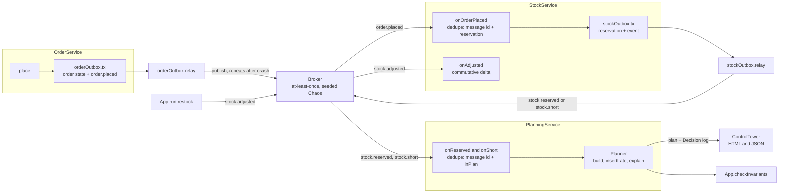
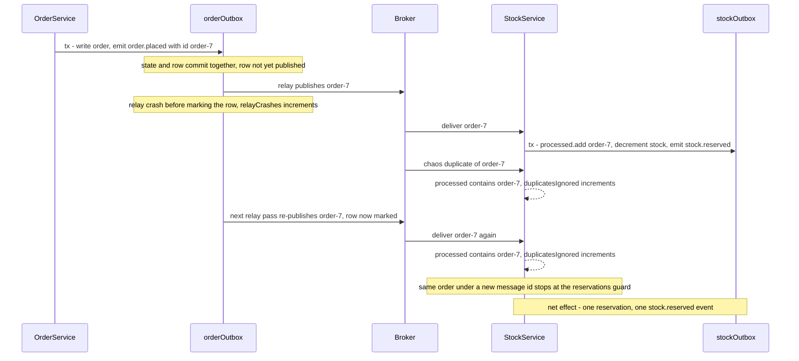
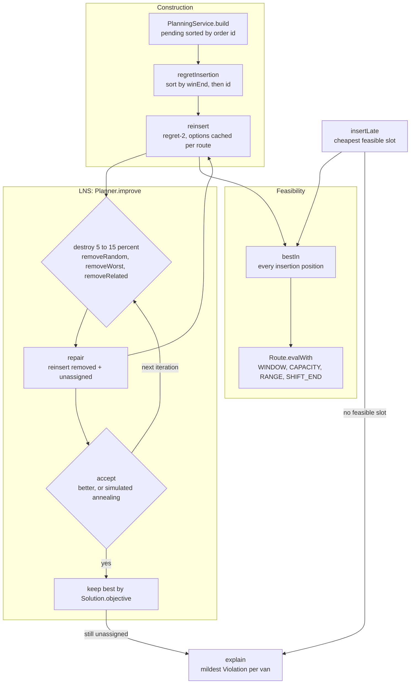

# Milkrun

[](https://github.com/ombdj1209/milkrun/actions/workflows/ci.yml)

**Event-driven order-to-route pipeline for grocery delivery, built to stay correct when messaging misbehaves.** Order intake, stock reservation and van route planning run as three services connected by an at-least-once broker and transactional outboxes. The router plans electric vans with 60-minute customer slots, capacity and battery range, re-plans live as late orders arrive, and explains every decision. A chaos mode injects duplicate deliveries, reordering and relay crashes, and an invariant checker proves nothing was oversold, planned twice or silently dropped.

Java 21 with **zero dependencies**: it compiles and runs with a bare JDK. All orders, stock and geography are synthetic.

## At a glance

- **Three services, one broker, two outboxes.** `OrderService` and `StockService` commit state and outgoing events atomically through `Outbox.tx`; a relay publishes them to an at-least-once `Broker`. `PlanningService` consumes reservations and owns the live plan.
- **Exactly-once effects on an at-least-once transport.** Every consumer deduplicates on message id and on business key. Under heavy chaos (30% duplicates, 8-message reorder window, 10% relay crashes) there were **0 invariant violations** across five evenings.
- **Planning quality you can measure.** Regret-2 insertion places every order; large neighbourhood search (LNS) then cuts distance by **22% on average** with the same fleet. Every plan passes an independent feasibility check.
- **Live re-planning in well under a millisecond.** Late orders are inserted in **0.06 to 0.07 ms at p50**, or rejected with a computed, per-constraint reason.
- **Deterministic.** All randomness is seeded and the planner is iteration-bounded, so the same seed replays the same plan, with or without chaos.
- **Ten tests**, a hand-rolled runner, and CI on every push and pull request.

## Tech stack

| Layer | Technology | Used for |
|---|---|---|
| Language | Java 21: records, local records, enums with `EnumMap`, arrow-form `switch` expressions, text blocks, `var`, `Stream.toList()`, `String.formatted` | Immutable domain types (`Order`, `Vehicle`, `Params`, `Eval`, `Message`, `Chaos`, `Decision`); LNS operator selection; the control tower HTML template |
| HTTP | `com.sun.net.httpserver.HttpServer` (JDK `jdk.httpserver` module), `java.net.InetSocketAddress` | Read-only control tower: `/`, `/api/plan`, `/api/decisions`, `/api/kpis` |
| I/O | `java.nio.file.Files`, `java.nio.file.Path`, `java.nio.charset.StandardCharsets`, `java.io.OutputStream` | Writing `results/*.json` and `results/control-tower.html`; HTTP response bodies |
| Collections | `java.util`: `ArrayDeque`, `LinkedHashMap`, `HashMap`, `HashSet`, `EnumMap`, `Comparator` | Broker queue and reordering; order intake in arrival order; dedupe sets; violation counts for explanations; deterministic sorting |
| Randomness | `java.util.SplittableRandom` | Seeded scenario generation, broker chaos, relay crashes and LNS, so every run is replayable |
| Functional interfaces | `java.util.function.Consumer` | Broker subscriptions and the `Outbox.tx` transaction body |
| Concurrency | Intrinsic locks (`synchronized` on `Outbox`) | Guarding the outbox rows; the pipeline itself is single-threaded and does not use `java.util.concurrent` |
| Tests | Hand-rolled runner in `Tests.java` (`test`, `check`, non-zero exit on failure) | Ten tests with no test framework |
| Build | `build.sh` (POSIX `sh`), `javac` or the `jdk.compiler` module as a fallback | `test`, `run` and `serve` targets from a bare JDK |
| CI | GitHub Actions (Temurin JDK 21, `./build.sh test`), Dependabot for GitHub Actions | Compile and test on push to `main` and on pull requests; monthly grouped action updates |

## Why this exists

Picnic's Warehouse Systems and delivery teams build in-house Java services on Spring, PostgreSQL, RabbitMQ and Kafka, and route their own electric vans. Two properties matter most in that world, and they are easy to claim and hard to show:

1. **Correctness under at-least-once delivery.** Duplicates and reordering are normal. Effects must still happen exactly once.
2. **Planning quality with a live plan.** Late orders must slot into tonight's routes in milliseconds, or be rejected with a reason a person can act on.

Milkrun makes both measurable.

## Architecture

### Event flow



`App.pump` alternates `Outbox.relay` and `Broker.drain` until both outboxes and the broker are empty, with a guard that fails the run if the pipeline does not quiesce.

| Piece | File |
|---|---|
| Routes, time windows, capacity, EV range, shift end | `plan/Model.java` |
| Nearest neighbour, regret-2 insertion, large neighbourhood search, live insertion, explanations | `plan/Planner.java` |
| At-least-once broker with duplicates and reordering | `msg/Broker.java` |
| Transactional outbox with atomic commit and crash-and-resend relay | `msg/Outbox.java` |
| Order, stock and planning services with idempotent consumers | `svc/Services.java` |
| Invariant checker and benchmark | `App.java` |
| Control tower: plan, decisions and KPIs as JSON and HTML | `api/ControlTower.java` |

### Outbox, relay crash and consumer dedupe

The relay publishes a row and only then marks it published. A crash between the two re-sends the row on the next pass. The consumer records the message id in the same transaction as its state change, so the second delivery is a no-op.



`PlanningService` applies the same two-level check: `processed` for message ids and `inPlan` for order ids, so a re-sent `stock.reserved` never plans an order twice.

### Planner pipeline



- **Objective.** `Solution.objective` is total km plus a fixed cost per van used plus a large penalty per unassigned order, so LNS never trades a placed order for a shorter route.
- **Feasibility.** `Route.evalWith` simulates a route with a candidate inserted, without mutating it: waits for early slots, flags a late arrival as `WINDOW`, then checks `CAPACITY` (totes), `RANGE` (battery km) and `SHIFT_END`. `Solution.feasible` re-evaluates every route independently of the planner's own bookkeeping.
- **Removal operators.** Random; worst (largest km saving, biased towards the top with a cubic draw); related (Shaw removal: nearest in space and slot start).

## Results

`./build.sh run` on one CPU core, Java 21. Each evening has 200 orders, 25 late orders and 12 vans (48 totes, 90 km range each); five seeds.

### Route quality

| Method | Mean km | Vans used | Orders left unassigned | Mean time |
|---|---|---|---|---|
| Nearest neighbour | 474.6 | 12.0 | **34.2** | 24 ms |
| Regret-2 insertion | 539.7 | 10.8 | 0 | 110 ms |
| Regret-2 + LNS (1,500 iterations) | **419.4** | 10.8 | 0 | 3.1 s |

Nearest neighbour looks short only because it leaves a sixth of the orders behind. Regret insertion places every order. LNS then cuts distance by **22% on average (16% to 29% across seeds)** with the same fleet. Every plan passed an independent feasibility check on windows, capacity, range and shift end.

### Correctness under chaos

Ten evenings: five clean, five with heavy chaos (30% duplicate deliveries, reordering within an 8-message window, 10% relay crashes after publish).

| | Clean | Heavy chaos (per evening) |
|---|---|---|
| Duplicate deliveries injected | 0 | 158 to 167 |
| Messages reordered | 0 | 291 to 324 |
| Outbox relay crashes (re-sends) | 0 | 42 to 60 |
| Duplicates ignored by consumers | 0 | 203 to 221 |
| **Invariant violations** | **0** | **0** |
| Replay with the same seed gives an identical plan | 5 of 5 | 5 of 5 |

### Live re-planning

Late orders arrive after the plan is built, alongside a restock. 114 of 117 late orders were inserted in the clean runs. The other 3 were rejected with a reason that counts, per constraint, how many vans rule the order out (time window, capacity, range or shift end). Insertion takes **0.06 to 0.07 ms at p50 and at most 0.12 ms at p99**, apart from one 3.0 ms JIT warm-up outlier in the first run. Stock-short orders (2% to 15% per evening) are logged as `not-planned` with the missing SKU.

Raw per-seed figures are in `results/results.json`; the plan and decision log for seed 1 under heavy chaos are in `results/plan.json`, `results/decisions.json` and `results/control-tower.html`.

## Reliability and invariants

**What chaos injects** (`Chaos.heavy(seed)`, all seeded):

| Fault | Where | Mechanism |
|---|---|---|
| Duplicate delivery | `Broker.publish` | With probability 0.30 the message is enqueued twice |
| Reordering | `Broker.drain` | With probability 0.5 per delivery, the head message is moved behind up to 8 later messages |
| Relay crash after publish | `Outbox.relay` | With probability 0.10 the relay stops after publishing a row but before marking it, so the row is re-sent on the next pass |
| Late orders and restock | `App.run`, clean and chaos runs | 20 `stock.adjusted` deltas and the late orders arrive after the plan is built |

**What is checked** (`App.checkInvariants`, after every evening):

1. Stock never goes negative (no oversell).
2. No order appears in two routes.
3. No order is both planned and unassigned.
4. Every reservation is either planned or explained as unassigned.
5. No order is planned without a reservation.
6. Every route in the final plan is feasible.
7. Every placed order is either planned or has an entry in the decision log (nothing silently dropped).

A second run with the same seed must produce the same `Solution.fingerprint`.

## Key engineering decisions and trade-offs

- **Idempotency at two levels.** Consumers deduplicate on message id (catches broker duplicates and relay re-sends) and on business key (catches the same order arriving under a new message id).
- **Dedupe state commits with the effect.** In `StockService` the `processed` insert is a `tx.write` inside the same outbox transaction as the reservation and the outgoing event. This is the in-memory equivalent of a processed-messages table in the same database transaction; without it, a crash between effect and marker would double-apply.
- **Commutative events where possible.** Restocks are deltas, so their arrival order does not matter. Only idempotency is needed, not ordering.
- **The outbox is all-or-nothing.** State changes and outgoing events commit together or not at all (tested with a failing transaction). Writes are buffered as `Runnable`s and only applied if the body completes.
- **Replayable planning.** The planner is seeded and iteration-bounded (never time-bounded), and it sorts its input, so the same evening always gives the same plan. The trade-off is that planning time varies with the machine rather than quality varying with load.
- **Explanations are computed, not written.** A rejection reports, per van, the constraint that rules the order out at its least-bad position.
- **Regret insertion caches options per route.** After each insertion only the modified route is re-evaluated, which keeps reinsertion fast enough to run inside LNS.
- **Unassigned orders are expensive, not forbidden.** A large per-order penalty in the objective keeps the search space connected: LNS can pass through states with unassigned orders but will not settle on one if a feasible placement exists.
- **Stand-ins with production-shaped surfaces.** `Broker` exposes `subscribe`, `publish` and `drain`, and `Outbox` exposes `tx` and `relay`, so a RabbitMQ or PostgreSQL adapter can replace them without touching the services.

## Testing strategy

`./build.sh test` runs ten tests through a dependency-free runner; any failure exits non-zero, which fails CI.

| # | Test | What it proves |
|---|---|---|
| 1 | route evaluation flags each constraint | `Route.evalWith` reports `CAPACITY`, `WINDOW` and range or window violations correctly, and waiting for an early slot is not a violation |
| 2 | every planner output is feasible and accounts for every order | Nearest neighbour and regret-2 produce feasible plans where planned plus unassigned equals the input, over three seeds |
| 3 | LNS never makes the objective worse and keeps feasibility | `improve` is monotone in the objective, its `LnsStats` agree with the returned solution, and the result stays feasible |
| 4 | same seed replays the same plan | Construction plus LNS is deterministic for a fixed seed |
| 5 | late insertion keeps the plan feasible or explains the rejection | `insertLate` either inserts feasibly or returns a computed `no feasible slot` explanation |
| 6 | outbox is atomic: a failing transaction writes nothing | A throwing `tx` body leaves no state change, no pending event and increments `rolledBack` |
| 7 | relay crash re-sends, consumer dedupe keeps effects exactly once | With a 50% relay crash rate, more than 5 deliveries occur but exactly 5 effects are applied and the outbox drains |
| 8 | heavy chaos: no oversell, no double planning, nothing dropped silently | Full pipeline over three seeds with all three faults firing and zero invariant violations |
| 9 | chaos runs replay deterministically | Two heavy-chaos runs with the same seed yield the same plan fingerprint |
| 10 | without chaos, order arrival order does not change the plan | Reordering alone does not change the plan unless it changes which orders win scarce stock |

## Repository layout

```text
.
├── .github/
│   ├── workflows/ci.yml          # Temurin JDK 21, ./build.sh test
│   └── dependabot.yml            # GitHub Actions updates
├── build.sh                      # test | run | serve, bare JDK only
├── results/
│   ├── results.json              # benchmark and chaos KPIs per seed
│   ├── plan.json                 # seed 1, heavy chaos
│   ├── decisions.json
│   └── control-tower.html
└── src/
    ├── main/java/nl/milkrun/
    │   ├── App.java              # evening runner, pump, invariants, benchmark
    │   ├── Scenario.java         # seeded synthetic city, orders, stock, fleet
    │   ├── api/ControlTower.java # HTML and JSON, JDK HttpServer
    │   ├── msg/                  # Broker, Chaos, Message, Outbox
    │   ├── plan/                 # Model, Planner
    │   └── svc/Services.java     # OrderService, StockService, PlanningService
    └── test/java/nl/milkrun/Tests.java
```

## Run it

```bash
./build.sh test    # 10 tests: constraint checks, feasibility, LNS monotonicity, replay, outbox atomicity,
                   #           crash-and-resend exactly-once effects, chaos invariants, order independence
./build.sh run     # benchmark, about a minute; writes results/results.json and results/control-tower.html
./build.sh serve   # control tower on http://localhost:8080  (/api/plan, /api/decisions, /api/kpis)
```

Only a JDK 21 is needed. The script uses `javac` if present, otherwise the JDK's built-in compiler module. With no argument it defaults to `run`.

On Windows without a POSIX shell, compile and run directly from PowerShell. The classpath separator is `;`:

```powershell
javac -d out/main (Get-ChildItem -Recurse -Filter *.java src/main/java).FullName
javac -cp out/main -d out/test src/test/java/nl/milkrun/Tests.java
java -cp "out/main;out/test" nl.milkrun.Tests     # tests
java -cp out/main nl.milkrun.App                  # benchmark
java -cp out/main nl.milkrun.App --serve          # control tower
```

## Limitations

- The broker and outbox are in-memory stand-ins for RabbitMQ and a PostgreSQL outbox table. The semantics are modelled; network partitions and consumer rebalancing are not.
- Under chaos, *which* orders win scarce stock can change with arrival order (the invariants still hold). A real system would need an explicit allocation policy for contested stock.
- Travel times are Euclidean distance times a detour factor, at constant speed. There is no road network, traffic or charging stop.
- Each van runs one trip. Multi-trip days, driver breaks and hub loading capacity are not modelled.
- It is framework-free by choice, so it stays runnable anywhere. A Spring Boot shell would wrap the same service classes.

## Production-readiness gaps

Beyond the modelling limitations above, these would need work before the code carried real traffic:

- **Durability.** All state, dedupe sets and outbox rows live in memory. `PlanningService` has no outbox, so the live plan and decision log are lost on restart.
- **Unbounded growth.** `processed` sets and published outbox rows are never pruned; production needs retention windows or compaction.
- **Business-key guard coverage.** The guard in `StockService.onOrderPlaced` checks reservations only. An order that was short on stock and is re-placed under a new message id would be evaluated again and could be logged twice.
- **Late insertion ignores elapsed time.** `insertLate` evaluates each route from the hub at shift start, so it does not account for vans already on the road.
- **Concurrency.** The pipeline is single-threaded and deterministic by design. Parallel consumers would need per-key ordering or locking around stock.
- **Control tower.** It serves a snapshot rendered at start-up, on all interfaces, with no authentication, TLS, pagination or rate limiting. JSON is built by hand with minimal escaping.
- **Observability.** No structured logs, metrics or traces; counters exist only as public fields read by the benchmark.
- **Replay proof.** `Solution.fingerprint` is a 32-bit string hash, adequate for tests but not a content-addressed identity.

## Next steps

1. Spring Boot adapters for the services, with RabbitMQ and a PostgreSQL outbox, using Testcontainers for the same chaos suite.
2. A road-network travel-time matrix (OSM-based) and charging stops.
3. Run Picnic's open-source error-prone-support checks in CI.
4. A contested-stock policy (earliest slot first, or loyalty-weighted) with fairness metrics.

## Security

See [SECURITY.md](SECURITY.md) for how to report a vulnerability.

## License

MIT, see [LICENSE](LICENSE).
